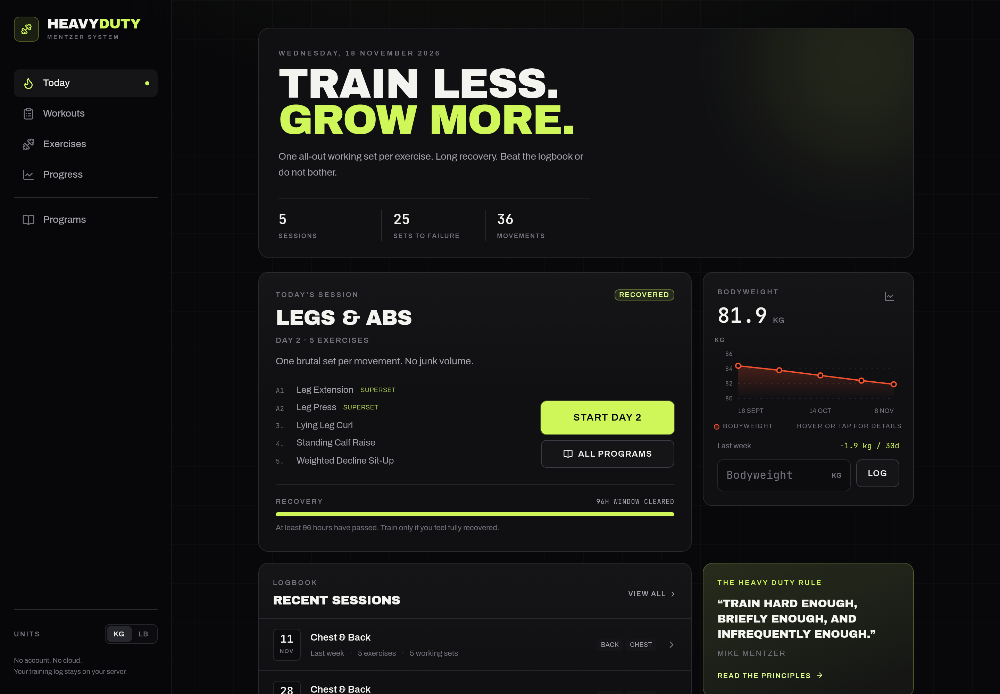
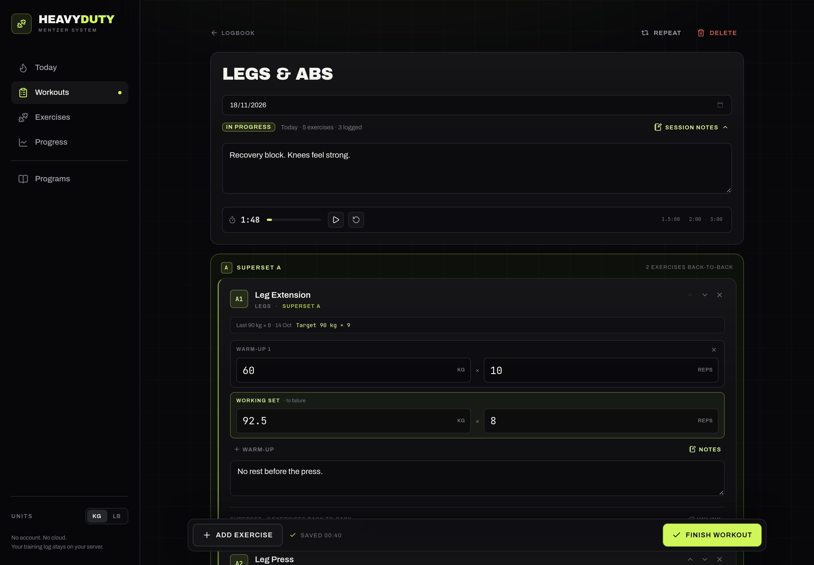
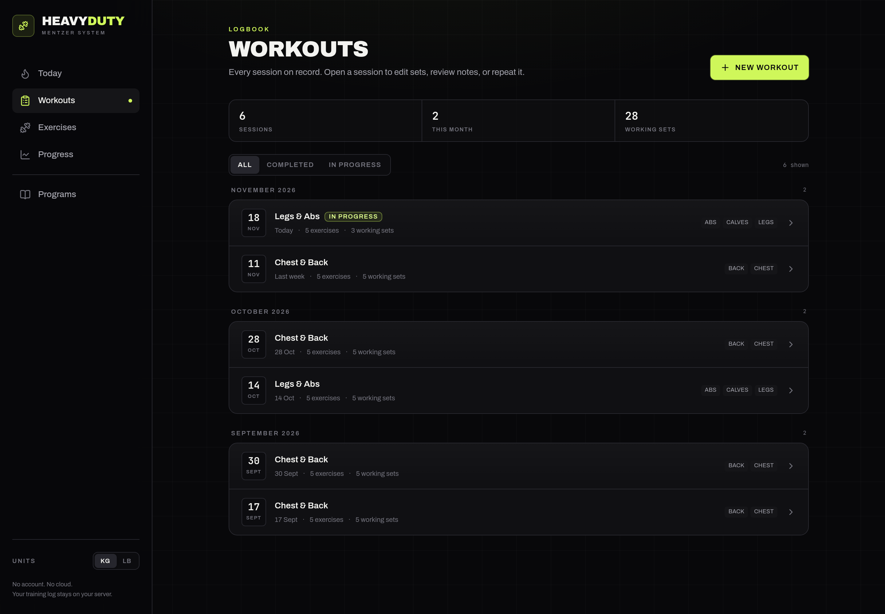
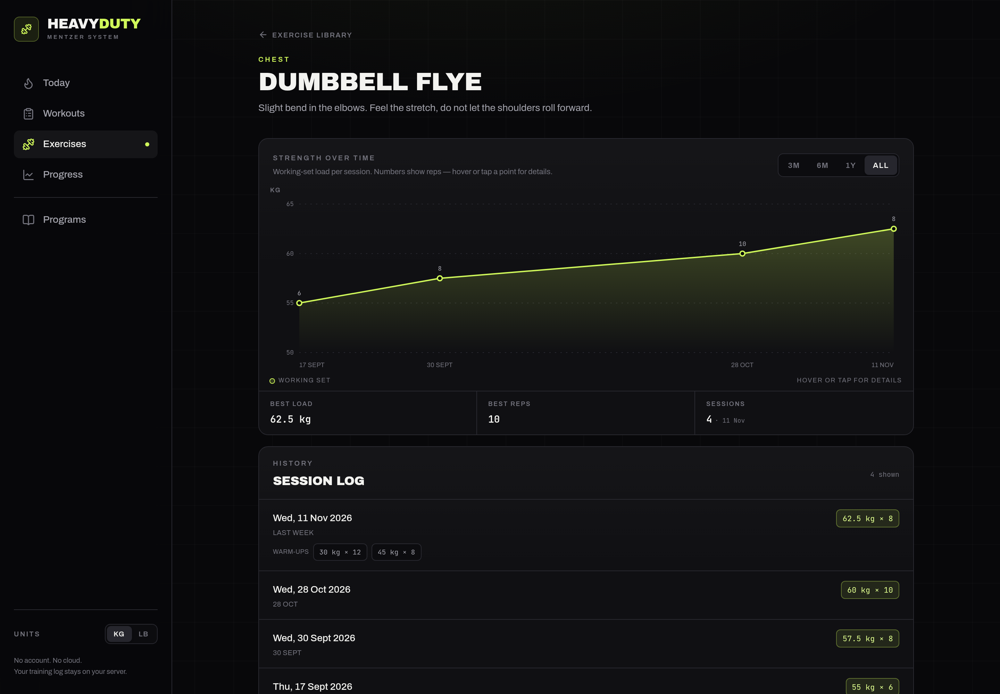
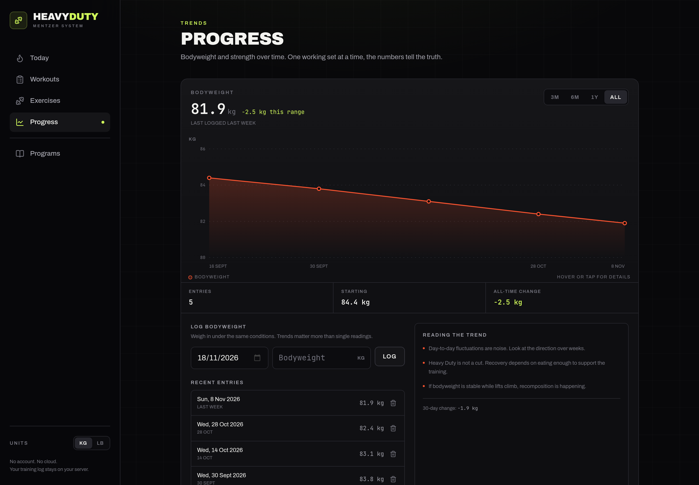
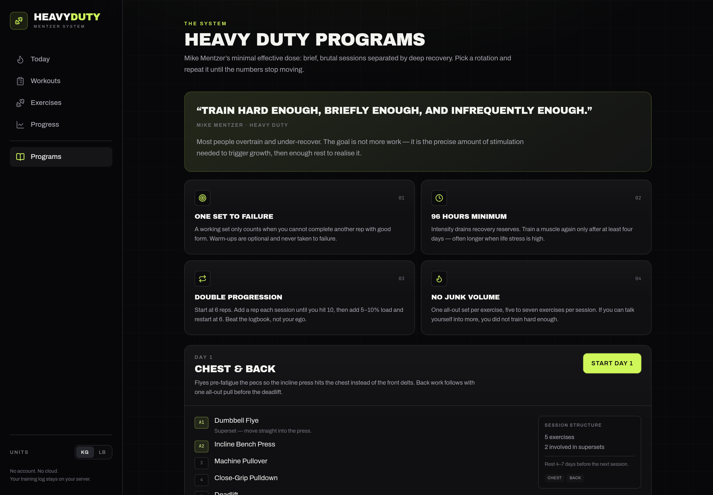
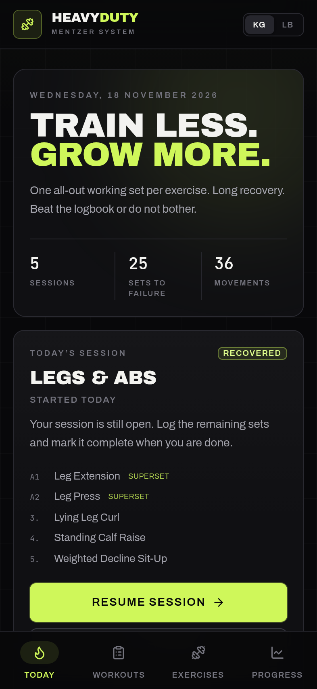

# Heavy Duty

A self-hosted training log for Mike Mentzer's **Heavy Duty** system. One
all-out working set per exercise, optional warm-ups, supersets, long recovery
windows, and double progression — all kept on your own server.

Built for a single lifter. There is no account system, no cloud sync, and no
telemetry.


## Screenshots

| | |
| --- | --- |
|  |  |
|  |  |
|  |  |

<p align="center">
  
</p>

## Features

- **Session logging** — warm-up sets are optional; every exercise has exactly
  one working set, taken to failure.
- **Supersets** — link adjacent exercises into A1/A2, B1/B2 groups.
- **Autosave** — the editor saves as you type. Close the tab mid-session and
  resume later.
- **Heavy Duty programs** — Chest & Back, Legs & Abs, Shoulders & Arms, and
  Full Body, with the next program suggested automatically.
- **Double progression** — each exercise shows the weight and reps from its
  last completed session, however long ago that was, plus a target: add reps
  until the top of the 6–10 range, then add weight.
- **History charts** — weight per session with reps shown on hover or tap.
- **Bodyweight tracking** — log weight over time with a 30-day delta.
- **Exercise library** — 36 seeded movements plus custom exercises.
- **Metric or imperial** — toggle kg/lb; weights are stored in kg.
- **Responsive** — desktop sidebar and a mobile layout built for the gym floor.

## Quick start (Docker Compose)

Requirements: Docker with the Compose plugin.

### Pull the published image

```bash
curl -O https://raw.githubusercontent.com/Errol-Hassall/Heavy-Duty/main/docker-compose.hub.yml
docker compose -f docker-compose.hub.yml up -d
```

Open <http://localhost:3000>.

`latest` tracks `main`. Every push also publishes a short commit SHA tag, and
pushing a git tag like `v1.1.0` publishes `1.1.0` and `1.1`. Edit the `image:`
line to pin one.

### Build from source

```bash
git clone https://github.com/Errol-Hassall/Heavy-Duty.git heavy-duty
cd heavy-duty
cp .env.example .env        # optional; sets the host port
docker compose up -d --build
```

Open <http://localhost:3000>.

To use a different host port, edit `APP_PORT` in `.env`:

```dotenv
APP_PORT=8080
```

Then run the same `up` command again.

The database lives in the named volume `heavy-duty-data`, so recreating the
container does not lose your log.

### Without Compose

```bash
docker build -t heavy-duty .
docker run -d \
  --name heavy-duty \
  -p 3000:3000 \
  -v heavy-duty-data:/data \
  --restart unless-stopped \
  heavy-duty
```

## Local development

Requirements: **Bun** (the app uses the `node:sqlite` compatibility module,
which Bun ships built in). No native build tools are needed.

```bash
bun install
bun run dev
```

The dev server runs at <http://localhost:3000>. The SQLite file is created at
`data/heavy-duty.db` on first request, and the exercise library is seeded
automatically.

```bash
bun run typecheck   # TypeScript
bun run lint        # ESLint across src/, tests/, and e2e/
bun run build       # production build into .output/
bun start           # run the production build
bun run db:reset    # delete the local SQLite file (dev only)
```

## Tests

The project has three layers of tests:

```bash
bun run test              # unit + integration (Vitest, real SQLite)
bun run test:unit         # pure logic only
bun run test:integration  # repository/database behavior
bun run test:coverage     # Vitest with V8 coverage
bun run test:e2e          # Playwright against the production build
bun run test:all          # full gate: typecheck + lint + both suites
```

The integration suite creates a temporary SQLite file, runs the real migrations
and seeding, and exercises the repository directly. The end-to-end suite builds
the app, boots the production server on `127.0.0.1:3100`, and writes to a fresh
`.test-data/e2e.db`; your development database is never touched.

Playwright uses `/usr/bin/chromium` when it is present. On another machine,
install a browser with `bunx playwright install chromium` or point
`PLAYWRIGHT_CHROMIUM_PATH` at an existing Chromium executable.

Useful focused commands:

```bash
bunx vitest run tests/unit/dates.test.ts
bunx playwright test e2e/heavy-duty.spec.ts --headed
```

## Continuous integration

The GitHub Actions pipeline in `.github/workflows/ci.yml` runs on every push
to `main` and on pull requests, in two parallel jobs:

- **Typecheck, lint, and unit + integration tests** — `bun install
  --frozen-lockfile`, then `bun run typecheck`, `bun run lint`, and
  `bun run test`.
- **Playwright E2E** — installs Playwright's Chromium with system
  dependencies, then runs `bun run test:e2e` against a fresh production
  build. On failure, the Playwright HTML report and test artifacts are
  uploaded for inspection.

A separate workflow, `.github/workflows/docker.yml`, builds the image on every
push to `main` and publishes it to Docker Hub as `errolhassall/heavy-duty`
(`latest`, a short commit SHA tag, and semver tags for `v*` git tags). It needs
the `DOCKERHUB_USERNAME` and `DOCKERHUB_TOKEN` repository secrets.

## Configuration

| Variable        | Default               | Description                                      |
| --------------- | --------------------- | ------------------------------------------------ |
| `DATABASE_PATH` | `data/heavy-duty.db`  | SQLite file. The parent directory is created.    |
| `PORT`          | `3000`                | Port the server listens on.                      |
| `HOST`          | `0.0.0.0`             | Bind address. Use `127.0.0.1` behind a proxy.    |
| `APP_PORT`      | `3000`                | Compose-only: host port mapped to container 3000.|
| `NODE_ENV`      | —                     | Set to `production` in the Docker image.         |

Schema migrations and exercise seeding run automatically at startup. The app
uses `PRAGMA user_version` and idempotent inserts, so upgrades are safe.

## Data, backup, and restore

All state is in one SQLite database inside `/data`. WAL mode is enabled, so the
database directory may also contain `-wal` and `-shm` files.

**Back up the named volume:**

```bash
docker compose stop heavy-duty

docker run --rm \
  -v heavy-duty-data:/data \
  -v "$PWD":/backup \
  alpine tar czf /backup/heavy-duty-backup.tar.gz -C /data .

docker compose start heavy-duty
```

**Restore:**

```bash
docker compose stop heavy-duty

docker run --rm \
  -v heavy-duty-data:/data \
  -v "$PWD":/backup \
  alpine sh -c "rm -rf /data/* && tar xzf /backup/heavy-duty-backup.tar.gz -C /data"

docker compose start heavy-duty
```

### Bind mount instead of a named volume

If you prefer a visible `./data` directory, add this override:

```yaml
# docker-compose.override.yml
services:
  heavy-duty:
    volumes:
      - ./data:/data
```

Create the directory first and give it to UID/GID `1000` (the container runs as
the unprivileged `bun` user):

```bash
mkdir -p data
sudo chown -R 1000:1000 data
```

## Security

**This app has no authentication.** Anyone who can reach the port can read and
change your training log. Do not expose it directly to the public internet.

For remote access, put it behind a VPN (Tailscale, WireGuard) or a reverse proxy
that enforces authentication and HTTPS. The container runs as a non-root user
and drops privilege escalation via `no-new-privileges`.

## How the program works

- **One working set per exercise**, taken to momentary muscular failure.
- **Warm-ups are optional** and never counted toward volume.
- **Recovery is part of the program.** The dashboard tracks days since your last
  completed session and clears the 96-hour window after four days. It is a
  guideline, not a green light — train only when you feel fully recovered.
- **Double progression**: stay at the same load and add reps until you reach 10,
  then add weight and restart at 6. The editor always shows the last completed
  weight and reps so the logbook is the only thing you need to beat.
- **Beat the logbook** or the set did not count.

Suggested rotation: Chest & Back → Legs & Abs → Shoulders & Arms → rest and
repeat, training roughly every 4–7 days depending on recovery.

## Project structure

```text
src/
  routes/              file-based TanStack Router pages
    index.tsx          dashboard, recovery, bodyweight
    workouts/          logbook, new session, live editor
    exercises/         library and per-exercise history
    progress.tsx       bodyweight and strength overview
    programs.tsx       program reference
  components/          UI, editor, charts, dialogs, picker
  server/
    db.ts              SQLite init, migrations, seeding
    repo.ts            repository and workout persistence
    api.ts             zod-validated server functions
  lib/                 types, units, dates, progression, programs
  styles.css           Tailwind v4 theme and base styles
tests/
  unit/                pure functions and validation schemas
  integration/         repository against a real SQLite database
e2e/                   Playwright interaction suite
```

## Notes

- Weights are stored in kilograms; the kg/lb toggle only changes display and
  input conversion.
- The chart is a small custom SVG component, so there is no charting runtime.
- Heavy Duty is a training philosophy, not medical advice. Progressive overload
  and recovery needs vary; use your own judgment.
